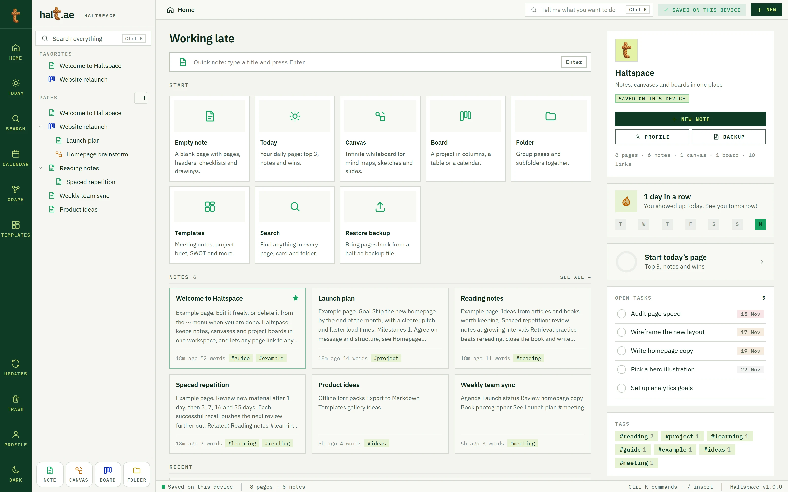
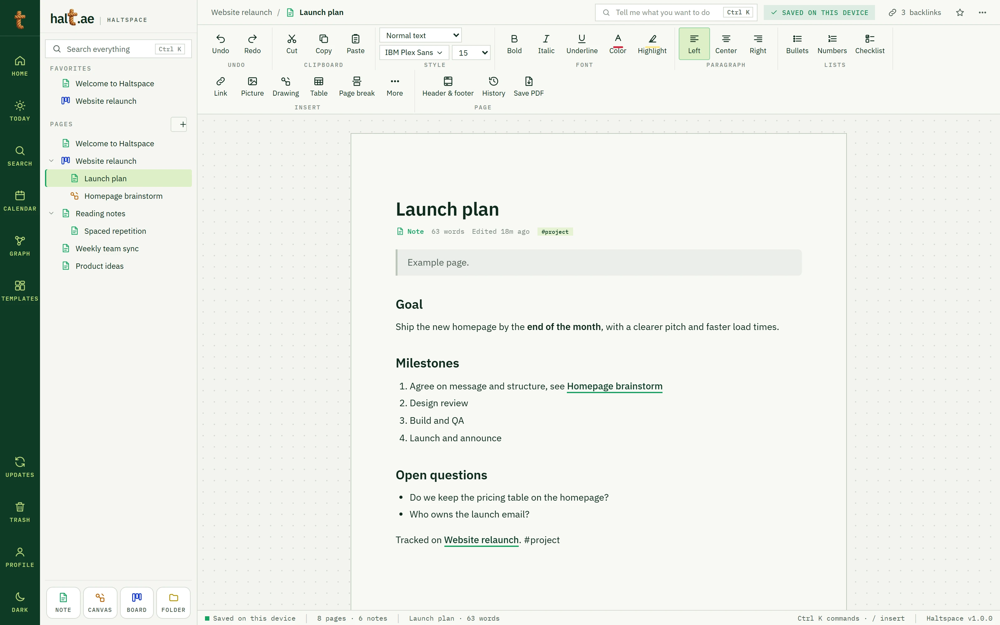
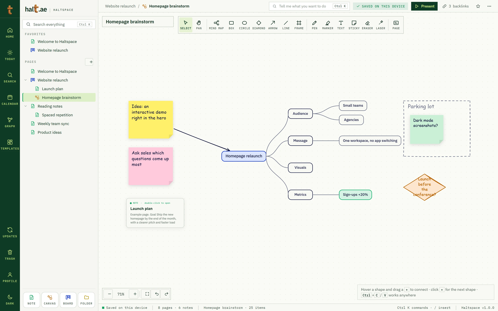
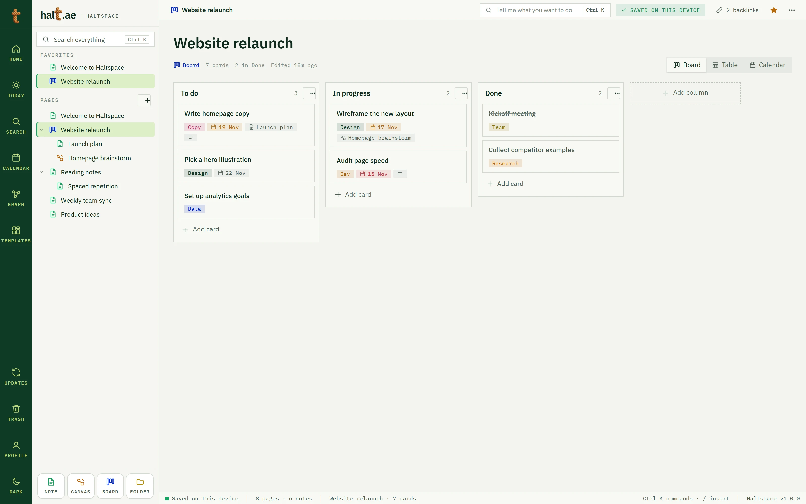
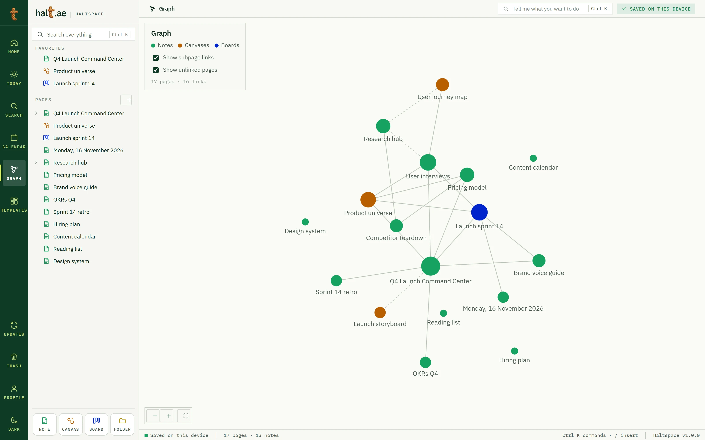
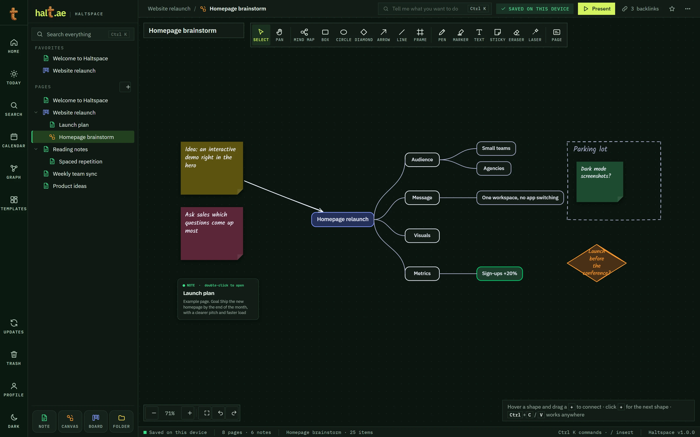
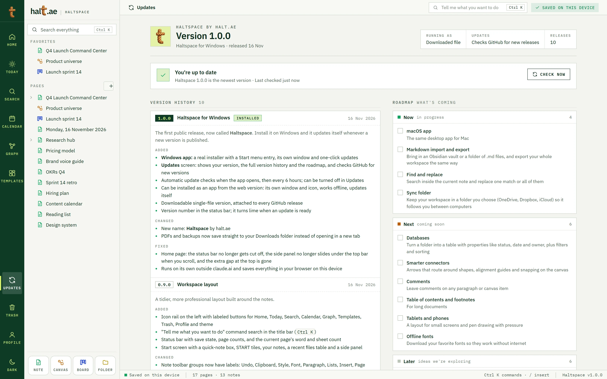

# Haltspace

**by halt.ae**: notes, infinite canvases and project boards in one app, all linked together. Write like in Word, sketch like on a whiteboard, plan on boards, and connect everything with `[[links]]`.

### [⬇ Download Haltspace for Windows](https://ssaad5678.github.io/haltspace/)

Free · Windows 10 and 11 · about 2 MB · updates itself · no account

[Download page](https://ssaad5678.github.io/haltspace/) · [All releases](https://github.com/ssaad5678/haltspace/releases/latest) · [Use it in your browser](https://ssaad5678.github.io/haltspace/app/) · [What's new](CHANGELOG.md) · [Roadmap](ROADMAP.md)



## One app instead of many

Haltspace is a free alternative to the tools people switch between all day:

<p>


</p>

| | Instead of | Haltspace gives you |
| --- | --- | --- |
|  | **Notion** | Pages inside pages, folders, templates and a `/` slash menu |
|  | **Obsidian** | `[[Links]]` between pages, backlinks, tags and a graph view, all saved on your device |
|  | **Evernote** | Quick notes, checklists, tags, global search and a daily page |
|  | **OneNote** | Notebooks with folders and nested pages, with drawings and pictures inside your notes |
|  | **Microsoft Word** | Real A4 pages, a labeled toolbar, headers and footers, and Save as PDF |
|  | **Excalidraw** | Hand-drawn shapes, arrows and freehand pen, with drawings you can drop into notes |
|  | **Miro** | An infinite whiteboard with sticky notes, mind maps, frames and presentation mode |
|  | **Trello** | Project boards with cards, due dates and labels, plus table and calendar views |
|  | **Google Keep** | Fast checklists and sticky notes, with open tasks on your start screen |

<sub>All product names and logos are trademarks of their owners. Haltspace isn't affiliated with or endorsed by them. Logos come from [Simple Icons](https://simpleicons.org) (CC0); OneNote and Word are shown as plain monograms because Microsoft's logos aren't licensed for this use.</sub>

## Screenshots

| Notes | Whiteboard |
| --- | --- |
|  |  |
| **Boards** | **Graph** |
|  |  |
| **Dark mode** | **Updates** |
|  |  |

## Install

### Windows (recommended)

1. Open the [latest release](https://github.com/ssaad5678/haltspace/releases/latest).
2. Download **`Haltspace_x.y.z_x64-setup.exe`** and run it. You don't need admin rights.
3. Open Haltspace from the Start menu.

Windows may show "Windows protected your PC" because the installer isn't code-signed yet. Click **More info → Run anyway**.

**Updates:** Haltspace checks for new versions when it opens. When one is ready, you'll see a notice. Click **Restart to update** on the Updates screen and it installs the new version and reopens, with your notes untouched.

### Online, or on any computer

- **Online:** open https://ssaad5678.github.io/haltspace/app/ in Chrome or Edge. Click the install icon in the address bar to add it as an app. It updates itself.
- **Single file:** download `halt-workspace.html` from the release and open it in any browser.

> Your notes are stored on your own computer. Nothing is uploaded. Use **Home → Backup** now and then to save a copy of everything, and **Restore backup** to bring it back on another computer.

## Features

- **Notes:** A4 pages, Word-style toolbar, headers and footers, PDF export, `/` slash menu, templates, daily notes
- **Canvas:** shapes, quick connectors, sticky notes, pen and marker, pasted images you can draw on, frames and presentation mode
- **Boards:** cards, due dates, table and calendar views
- **Organize:** folders, global search, tags, a graph of linked pages, trash and version history
- **Safe:** autosave, an extra copy on your device, backup and restore

## Publishing an update (maintainer)

1. Make your changes in `src/halt-workspace.html`.
2. Add a new entry at the top of `CHANGELOG.md` with a higher version, for example `## [1.1.0] - 2026-12-01 - Markdown export`. Tick off anything finished in `ROADMAP.md`.
3. Commit and push to `main`.

GitHub Actions then:

- updates the web version on GitHub Pages
- creates release **v1.1.0** with your notes
- builds the Windows installer (about 10 minutes) and attaches it with the update feed

Everyone with Haltspace installed gets the update the next time they open it. Pushing without a new CHANGELOG version only updates the web version.

### One-click updates for the Windows app

Installed copies verify every update with a signing key. The key is in `%USERPROFILE%\.tauri\haltspace.key` on the maintainer's PC. Keep it private, and never commit it. To let GitHub sign releases, add it once:

1. Open the repository's **Settings → Secrets and variables → Actions → New repository secret**.
2. Name: `TAURI_SIGNING_PRIVATE_KEY`. Value: the full contents of `haltspace.key`.

Without the secret, releases still include the installer. Installed copies then show "Download installer" instead of "Restart to update".

### Work on it locally

```bash
node serve.js
```

That serves the app at http://localhost:5178 straight from `src/`.

```bash
npm run build:windows
```

That builds the Windows installer into `src-tauri/target/release/bundle/`. It needs Rust and the Visual Studio C++ build tools.

## Project layout

| Path | What it is |
| --- | --- |
| `src/halt-workspace.html` | The whole app: HTML, CSS and JavaScript in one file |
| `src-tauri/` | The Windows app: window, installer settings and auto-updater (Rust, Tauri 2) |
| `CHANGELOG.md` | Version history; it feeds the in-app Updates screen and GitHub releases |
| `ROADMAP.md` | Planned features, shown under Updates in the app |
| `landing/index.html` | The download page at ssaad5678.github.io/haltspace |
| `docs/screenshots/` | Product screenshots used by the download page and this README |
| `public/` | Web-app files: manifest, icons, offline service worker |
| `scripts/build.js` | Builds `dist/` (web) and `dist-desktop/` (Windows), and syncs version info into the app |
| `.github/workflows/release.yml` | Publishes the web version, creates releases and builds the Windows app on every push |
| `serve.js` | Local preview server |
